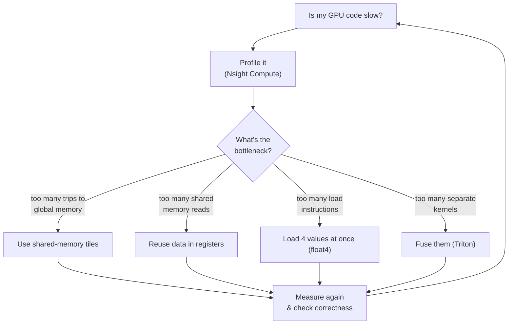

<p align="center">
  
</p>

<p align="center">
  
  
  
  
  
  
</p>

## In short

**Matrix multiplication** is the math that powers almost all of modern AI. Every time a model like ChatGPT answers you, its GPU is multiplying huge grids of numbers.

In this project I wrote my **own matrix multiplication code for an NVIDIA GPU** (in CUDA) and made it faster step by step:

1. I started with the simplest possible version.
2. I used a **profiler** (a tool that shows what the GPU is busy with) to find out why it was slow.
3. I fixed the biggest problem, measured again, and repeated.

My final version is **5.2× faster** than where I started and reaches **66% of the speed of NVIDIA's own expert-built library (cuBLAS)** on large matrices.

In Part B I went one level up. I wrote a **Triton** kernel that does three AI steps in one go instead of three, and compared it with plain PyTorch and `torch.compile`.

> Every number in this README was measured on my laptop and is backed by a file in [results/](results/) or [Profiling_Results/](Profiling_Results/).

---

## Contents

- [What is matrix multiplication?](#1-what-is-matrix-multiplication)
- [Why is it hard to make fast?](#2-why-is-it-hard-to-make-fast)
- [The journey: 4 versions, each smarter](#3-the-journey-4-versions-each-smarter)
- [Results](#4-results)
- [How I found out why: profiling](#5-how-i-found-out-why-profiling)
- [Bonus: Tensor Cores and smaller numbers](#6-bonus-tensor-cores-and-smaller-numbers)
- [Part B: kernel fusion with Triton](#7-part-b-doing-3-steps-in-1-with-triton)
- [What I learned](#8-what-i-learned)
- [Glossary](#glossary-in-plain-words) · [How I measured](#how-i-measured-fairly) · [Repo layout](#repo-layout) · [Reproduce](#reproduce) · [Full numbers](#full-technical-details)

---

## 1. What is matrix multiplication?

A **matrix** is just a grid of numbers. To multiply two matrices **A × B = C**, every box in the answer grid **C** is made by taking **one row of A** and **one column of B**, multiplying the numbers pair by pair, and adding them all up.

<p align="center"></p>

That is easy for a 4 × 4 grid. In this project the grids are up to **4096 × 4096**. That is **16.8 million answer boxes**, each needing **4,096 multiply-adds**, which comes to about **137 billion math operations** for one multiplication.

A GPU is great at this because it has thousands of small workers (**threads**) that can each fill in different answer boxes **at the same time**.

> **GEMM** ("GEneral Matrix Multiply") is just the industry name for this operation.

---

## 2. Why is it hard to make fast?

Here's the surprising part: **the math is not the slow part. Fetching the numbers is.**

A GPU can multiply numbers much faster than it can bring them in from its main memory. Think of a kitchen:

| GPU part | Kitchen version | Size | Speed |
|---|---|---|---|
| **Global memory** | the big storeroom down the hall | huge (6 GB) | slow, far away |
| **Shared memory** | the counter your team shares | small | fast |
| **Registers** | what's already in your hands | tiny | fastest |

If a cook walks to the storeroom for **every single ingredient**, most of their time is spent walking, not cooking. Every version in this project is about **cutting down the walking**.

---

## 3. The journey: 4 versions, each smarter


<sub>Speeds at N = 4096. GFLOPS = billions of math operations per second.</sub>

The animation below shows how each version moves numbers around. **Each dot is a number being fetched.** Watch how the trips get fewer and shorter as you go down:

<p align="center"></p>

### Step 1: Naive (the starting point)
Each thread computes **one** answer box. For every multiply, it walks all the way to global memory for both numbers. Simple, but the GPU spends most of its time waiting for data.

### Step 2: Shared-memory tiles
A team of threads works together. They copy a **32 × 32 block ("tile")** of numbers onto the shared counter **once**, and then everyone reads from there. Far fewer trips to the storeroom.
**Result: 1.5× faster.** But each multiply still needs **2 reads** from the shared counter, and that became the new traffic jam.

### Step 3: Register tiling (the big win)
Now each thread computes a **4 × 4 patch (16 answers)** and keeps them in its own registers (its "hands"). Each number it picks up is reused **4 times** before being put down. Reads per multiply drop from **2 to 0.5**.
**Result: 3.3× faster than step 2**, with no "register spills" (the thread never runs out of hand space).

### Step 4: float4 vector loads
Same plan, but instead of grabbing numbers one at a time, a thread grabs **4 at once** in a single instruction (`float4`). To make this possible, I stored one tile **transposed** (flipped) in shared memory. Load instructions per step dropped from **5 to 2**.
**Result: +30% at N = 1024, +6% at N = 4096.**

---

## 4. Results

### Speed of each version

<p align="center"></p>

- My best kernel is **5.2× faster** than the naive one.
- It is about **480× faster** than a single CPU core doing the same job.
- NVIDIA's cuBLAS (gray) is the gold standard, built by NVIDIA's own experts over many years.

### At different matrix sizes

<p align="center"></p>

### How close did I get to the experts?

<p align="center"></p>

| Matrix size | Naive | Tiled | Register tiling | + float4 (best) | cuBLAS | Best vs naive |
|---|---:|---:|---:|---:|---:|---:|
| 1024 | 670 | 764 | 3,799 | **4,923** | 5,761 | **7.3×** |
| 2048 | 668 | 966 | 3,694 | **3,732** | 7,307 | **5.6×** |
| 4096 | 645 | 970 | 3,173 | **3,375** | 5,119 | **5.2×** |

<sub>GFLOPS, median of 3 runs. Source: <code>results/gemm_regtiled_vec_run1..3.csv</code>.</sub>

✅ **Every version gives the correct answer.** Each one is checked against a CPU result before its time is counted. The best kernel was also tested on awkward sizes (1000 and 1023, which don't divide evenly into tiles) and passed every check.

---

## 5. How I found out *why*: profiling

Guessing is not enough. I used **NVIDIA Nsight Compute**, a tool that looks inside the GPU while the code runs and reports what it is busy with. It's like a fitness tracker for the GPU.

<p align="center"></p>

What the profiler told me, in plain words:

| Version | What was slowing it down |
|---|---|
| Naive | Most instructions were **"fetch a number"**, not "do math". The memory pipeline was full. |
| Tiled | The **shared-memory request line** was jammed (2 reads per multiply). |
| Register tiling | Shared-memory requests cut by 4× and total instructions cut nearly in half. Math use jumped from **~7% to 31%**. |
| + float4 | Shared-load instructions dropped from **83.9 M to 33.6 M**. Math use rose to **43%**. |

### 🔬 I made a prediction, and it was partly wrong

Before step 4, I wrote down a [hypothesis](Profiling_Results/profile_hypothesis.md): *"register tiling issues 8 separate loads per step, and float4 will cut it to 2."*

The profiler showed it was really **5, not 8**. The compiler had already been clever and merged some of the loads for me. So the real improvement was **5 → 2 (2.5×)**, not 8 → 2. The profiler also showed that the **amount of data** moved stayed the same. The change saved *instructions*, not *data traffic*. The full write-up is in [vectorized_loads.md](Profiling_Results/vectorized_loads.md).

I'm keeping this in the README on purpose: **measuring beats assuming.**

---

## 6. Bonus: Tensor Cores and smaller numbers

So far everything used **FP32** (normal 32-bit decimal numbers). Modern NVIDIA GPUs also have **Tensor Cores**, special hardware that multiplies matrices much faster when you use smaller number formats (**TF32** and **FP16**). That's what AI training and inference use.

<p align="center"></p>

On the same laptop GPU, switching from FP32 to FP16 makes cuBLAS **4.5× faster**. This is why AI uses lower-precision numbers.

---

## 7. Part B: doing 3 steps in 1 with Triton

In a real neural network, a matrix multiply is usually followed by more steps. A very common pattern is:

```
output = GELU(A × B + bias)
```

Normal PyTorch runs this as **3 separate GPU programs** ("kernels"). Each one writes its full result to slow memory, and the next one reads it all back. I wrote a **single fused kernel in Triton** (a Python-like language for GPU code) that does all three steps in one pass and writes to memory only once.

<p align="center"></p>

I compared three versions (all in FP16):

- **PyTorch eager**: normal PyTorch, `F.gelu(a @ b + bias)`
- **torch.compile**: PyTorch's automatic optimizer on the same code
- **Triton fused (mine)**: one hand-written kernel, auto-tuned over 4 tile sizes

<p align="center"></p>

| Size | PyTorch eager | torch.compile | **Triton fused** | Triton vs eager |
|---|---:|---:|---:|---|
| 1024 | 0.318 ms | 0.352 ms | **0.204 ms** | 🟢 **1.56× faster** |
| 2048 | 0.991 ms | 1.062 ms | **0.932 ms** | 🟡 1.06× faster (within noise) |
| 4096 | 6.509 ms | 6.460 ms | 6.886 ms | 🔴 5.8% slower |

<sub>Median of 4 runs. Source: <code>results/fused_run1..4.txt</code>, <code>results/fused_results.csv</code>.</sub>

**Why does fusion win small and lose big?**
- At **small sizes**, the extra memory trips are a big share of the total time, so cutting them helps a lot.
- At **large sizes**, the matrix multiply itself takes almost all the time. PyTorch uses NVIDIA's highly tuned cuBLAS for that part, and it's a bit faster than my auto-tuned Triton tile.

**Bonus: it's also more accurate.** My fused kernel keeps the bias and GELU math in 32-bit before rounding once at the end. Its error against a high-precision reference was **~1.95e-3**, vs **~3.3e-3 to 3.8e-3** for PyTorch eager.

`torch.compile` was **not** faster than eager at any size I tested.

---

## 8. What I learned



1. **Moving data costs more than doing math.** Every big speed-up came from fetching numbers less often, not from doing less math.
2. **Profile first, then optimize.** The profiler showed exactly which part of the GPU was overloaded at each step.
3. **Write down a prediction, then check it.** My prediction was partly wrong, and finding that out taught me the most.
4. **Diminishing returns are real.** After step 4 the next big gain would need a full rewrite (bigger 8×8 tiles per thread), so I stopped and documented it.
5. **Fusion is not always a win.** It helps most when memory trips are a large share of the work.

**Not done yet (ideas for next steps):** an 8×8 register tile per thread, removing the small bank conflicts that step 4 introduced, double buffering (loading the next tile while computing the current one), and logging GPU clock speed during benchmarks.

---

## Glossary (in plain words)

| Word | Meaning |
|---|---|
| **GPU** | A chip with thousands of small cores, built to do many calculations at once |
| **CUDA** | NVIDIA's language (an extension of C++) for writing GPU programs |
| **Kernel** | A function that runs on the GPU, executed by many threads at once |
| **Thread** | One tiny worker on the GPU |
| **GEMM** | General Matrix Multiply, the industry name for matrix multiplication |
| **N** | The matrix size. N = 4096 means a 4096 × 4096 grid |
| **GFLOPS / TFLOPS** | Billions / trillions of math operations per second (speed) |
| **Global / shared memory / registers** | Storage on the GPU, from big and slow to tiny and fast |
| **Tile** | A small block of the matrix that's loaded and worked on together |
| **float4** | Loading 4 numbers in one instruction instead of 4 separate ones |
| **cuBLAS** | NVIDIA's official, expert-tuned math library (the benchmark to beat) |
| **Tensor Cores** | Special GPU hardware for fast matrix math in smaller number formats |
| **FP32 / TF32 / FP16** | Number formats: 32-bit, "tensor float 32", 16-bit. Smaller is faster but less precise |
| **Profiler (Nsight Compute)** | A tool that shows what the GPU is busy with while your code runs |
| **Triton** | A Python-like language from OpenAI for writing GPU kernels |
| **Kernel fusion** | Combining several GPU steps into one, to avoid extra memory trips |

---

## How I measured (fairly)

- ⏱️ Timed on the GPU with **CUDA events**, after **warm-up** runs.
- 🔁 Every result is the **median of repeated runs**, and each experiment was run **3 to 4 full times**. Ranges are reported.
- ✅ Every result is **checked for correctness** before its timing counts.
- 📦 Copying data between CPU and GPU is **timed separately** from the kernel.
- 🖥️ GPU state (`nvidia-smi`) and compiler version (`nvcc --version`) are saved with each run in [results/](results/).
- 🚫 Small sizes (N ≤ 512) are left out of comparisons because the runs are too short to time reliably.

**Hardware / software:** RTX 3060 Laptop GPU (30 SMs, compute capability 8.6, 6 GB), CUDA 13.1, Nsight Compute 2025.4.1, PyTorch 2.11 (cu128), Triton 3.8.0, Windows. FP32 peak used for percentages: 13.08 TFLOPS.

---

## Repo layout

```
cuda/gemm_benchmark.cu     all GEMM kernels + benchmark harness (C++/CUDA, cuBLAS)
profile_gemm.cu            runs one kernel once at one size, for Nsight Compute
triton/fused_bench.py      eager vs torch.compile vs Triton fused matmul + bias + GELU
scripts/                   env, build and benchmark scripts (PowerShell)
results/                   raw benchmark CSVs and run logs
Profiling_Results/         Nsight Compute CSVs, profile hypothesis, vectorized-load analysis
docs/make_figures.py       generates every chart/animation in this README (docs/images/)
```

## Reproduce

Windows, x64 Native Tools Command Prompt for VS 2022 / PowerShell with CUDA 13.1:

```powershell
. .\scripts\env.ps1
.\scripts\build.ps1
.\scripts\run_benchmark.ps1
python triton\fused_bench.py
```

Profile one kernel (needs an administrator terminal for GPU counters):

```powershell
nvcc -O3 -std=c++17 -arch=sm_86 -lineinfo profile_gemm.cu -o build\profile_gemm.exe -lcublas
ncu --set full --kernel-name regex:gemm_ --csv --page details --log-file Profiling_Results\out.csv .\build\profile_gemm.exe regtiled_vec 2048
```

Rebuild the README charts (standard library only):

```powershell
python docs\make_figures.py
```

---

## Full technical details

<details>
<summary><b>Part A benchmark with ranges (GFLOPS, median of 3 runs)</b></summary>

| N | naive | tiled | regtiled | regtiled_vec | cuBLAS FP32 |
|---|---|---|---|---|---|
| 1024 | 670 | 764 | 3799 (3168 to 3813) | 4923 (4153 to 5066) | 5761 |
| 2048 | 668 | 966 | 3694 (3494 to 3784) | 3732 (3598 to 4314) | 7307 |
| 4096 | 645 | 970 | 3173 (3151 to 3195) | 3375 (3300 to 3430) | 5119 |

Source: `results/gemm_regtiled_vec_run1..3.csv`. cuBLAS readings differ between sessions (6556 vs 7307 GFLOPS at N=2048), so percentages of cuBLAS are only compared within one session.

- Register tiling: 3.3x to 5.0x over `tiled`.
- Vectorized loads over `regtiled`: +30% at N=1024, +1% at N=2048 (ranges overlap, no real difference), +6% at N=4096.
- Best kernel: 51% to 85% of cuBLAS FP32 and 26% to 38% of the 13.08 TFLOPS FP32 reference peak.
- Single-threaded CPU at N=4096: 7 GFLOPS (`results/gemm_results.csv`).
- Host-device transfers at N=4096: pinned 10.2 GB/s host-to-device vs 9.4 GB/s pageable.
- cuBLAS at N=4096: FP32 5.1 TFLOPS, TF32 11.7 TFLOPS (2.3x), FP16 with FP32 accumulate 23.2 TFLOPS (4.5x).

| Kernel | Idea |
|---|---|
| `cpu_ikj_1thread` | single-threaded CPU reference (cache-friendly loop order) |
| `naive` | one thread per output, every operand read from global memory |
| `tiled` | 32x32 shared-memory tiles |
| `regtiled` | 64x64 block tile; each thread holds a 4x4 block of results in registers |
| `regtiled_vec` | `regtiled` plus a transposed, padded A tile so each thread reads its operands with `float4` shared loads |
| `cublas_fp32 / tf32 / fp16` | cuBLAS reference points (TF32 and FP16 use tensor cores) |

</details>

<details>
<summary><b>Nsight Compute profile (N = 2048)</b></summary>

Nsight Compute locks the SM clock to about 0.9 GHz, so durations differ from the benchmark.

| Metric | naive | tiled | regtiled | regtiled_vec |
|---|---|---|---|---|
| Instructions executed | 1467 M | 861 M | 465 M | 412 M |
| Warp cycles per issued instruction | 35.1 | 33.4 | 13.9 | see CSV |
| Share of FP32 peak (roofline) | ~7% | ~7% | 31% | 43% |
| L1/TEX throughput busy | | | 96.5% | 83.7% |
| Issue slots busy | | | 54.3% | 66.3% |
| Shared-load instructions | | | 83.9 M | 33.6 M |
| Registers per thread / spills | | | 64 / 0 | 64 / 0 |
| Kernel duration at profiler clock | | | 7.93 ms | 5.76 ms |

- `naive` and `tiled` both saturate the L1/TEX pipeline. `tiled` stalls mainly on the shared-memory instruction queue (2 shared loads per multiply-add).
- Register tiling cut shared loads per multiply-add to 0.5 and the instruction count nearly in half. No register spills, and no bank-conflict warning for `regtiled`.
- Vectorized loads cut shared-load instructions from 83.9 M to 33.6 M and the `mio_throttle` stall from 3.59 to 2.20 warps per issue. Shared-load wavefronts were unchanged (about 100.7 M), so the change removed instruction pressure, not shared-memory traffic.
- The transposed A store in `regtiled_vec` introduces 2-way bank conflicts, about 4% of shared wavefronts.
- At N=2048 the profiler shows `regtiled_vec` 27% shorter than `regtiled`, while the benchmark shows +1%. SM clocks were not logged during the benchmark, so no cause is claimed.

More: [PART_A_SUMMARY.md](Profiling_Results/PART_A_SUMMARY.md), [vectorized_loads.md](Profiling_Results/vectorized_loads.md), [profile_hypothesis.md](Profiling_Results/profile_hypothesis.md).

</details>

<details>
<summary><b>Part B details (Triton / torch.compile)</b></summary>

`triton/fused_bench.py` compares three FP16 implementations of `GELU(A @ B + bias)` (tanh form), square N x N x N. The Triton kernel does matmul, bias and GELU in one pass, with the epilogue in FP32 before a single FP16 store, autotuned over 4 tile configurations.

Method: 25 warm-up calls, 100 timed calls with CUDA events, median per run; 4 full runs; error checked against an FP32 reference.

| N | eager (ms) | torch.compile (ms) | Triton fused (ms) | Triton vs eager |
|---|---|---|---|---|
| 1024 | 0.318 (0.280 to 0.322) | 0.352 (0.320 to 0.402) | **0.204 (0.182 to 0.222)** | 1.56x faster |
| 2048 | 0.991 (0.973 to 1.005) | 1.062 (1.014 to 1.105) | 0.932 (0.892 to 0.991) | 1.06x faster (ranges overlap) |
| 4096 | 6.509 (6.447 to 6.548) | 6.460 (6.430 to 6.534) | 6.886 (6.846 to 6.902) | 5.8% slower |

- At N=4096 eager reaches 21.1 TFLOPS and Triton 20.0 TFLOPS.
- Triton max error 1.95e-3 to 1.98e-3 vs eager 3.25e-3 to 3.84e-3 against the FP32 reference.
- The Triton kernel supports sizes that are multiples of 128 only.
- The reason for the Triton result at each size was not profiled.

</details>

<details>
<summary><b>How Part A and Part B connect</b></summary>

Both parts ask the same question: how much time goes to arithmetic and how much to moving data. In Part A, each step that reduces loads per multiply-add (shared-memory tiles, then register tiles, then vectorized loads) moves the kernel closer to FP32 peak, and the profiles identify which resource is saturated before and after each change. cuBLAS at TF32 and FP16 then shows how much more throughput the tensor-core path delivers on the same hardware.

Part B applies the same idea above the kernel level. Eager `matmul + bias + GELU` runs as separate operations; the Triton kernel does all three in one pass on the tensor-core path. Fusion clearly wins at N=1024, ties at N=2048, and loses at N=4096, where the large matmul dominates runtime and PyTorch's cuBLAS-backed matmul beats the autotuned Triton tile. Whether fusion pays off depends on how close the underlying matmul already is to hardware limits, which is exactly what Part A measures.

</details>
